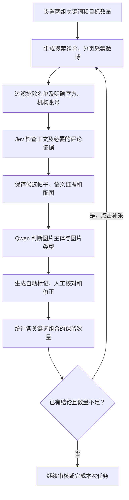

# 微博图文采集与筛选项目：整体流程介绍

> 下文记录的是旧版图文采集流程。2026 年 10 月 26 日起，“主题评价”已改为通用对象评价判断，不限制对象类别、不要求图片，也不再排除评价目标为私人宠物的文本。新任务使用主题卡片，图片识别为独立选项，关系不确定的记录进入待复核；历史文件与人工标记保留。当前操作请以 [语义筛选与数量说明](主题相关筛选.md) 为准。

## 1. 项目要做什么

本项目基于 MediaCrawler，围绕两组关键词采集微博图文，并结合文本语义模型、图片识别模型和人工复核，筛选出符合研究要求的帖子。

关键词一通常是“可爱、萌”等评价词，关键词二是“公园、墙绘、花箱”等评价对象或元素。项目关注的不只是两个词是否出现，还包括：**评价是否与目标评价对象或元素有关、发布账号是否符合要求，以及是否至少有一张可保留的图片。**

## 2. 整体流程

### 第一步：配置关键词和采集目标

用户可以手动输入关键词，也可以分别上传两个 TXT 文件。程序解析逗号等分隔符，生成关键词标签，并将两组词两两组合搜索。例如：

- 关键词一：可爱、萌。
- 关键词二：公园、墙绘。
- 搜索组合：可爱 公园、可爱 墙绘、萌 公园、萌 墙绘。

同时设置目标数量、评论采集选项和模型配置。

### 第二步：搜索采集与账号过滤

程序按搜索组合分页获取帖子，读取正文和账号信息，必要时继续采集评论以寻找文本证据。

名单中的营销、媒体、政务账号，以及根据账号信息明确识别出的官方媒体、政务或机构账号直接排除，并记录原因。**其余账号目前默认勾选“个人／非营销号”**，方便后续审核；这一勾选是流程默认值，不代表已证明账号一定没有营销行为，人工仍可纠正。

### 第三步：Jev 进行文本语义初筛

Jev 负责理解文字，主要判断：

- 关键词一究竟在评价什么对象。
- 该对象与关键词二所指的评价对象或元素是否有实际关联。
- 评价是否在描述自己的宠物，或其他不符合要求的对象。

例如，“公园里的小鹿好可爱”可以作为评价对象相关候选；“我家的小狗好可爱，今天带它去公园”仍然是在评价自己的宠物，应排除。

明确拒绝或明确属于私人宠物的结果直接排除；不确定的结果保留相关证据，进入人工复核候选。程序还会核对实际文本中的关键词证据，不能只因搜索组合含有两个词，就认为帖子满足要求。正文证据不足时继续查找评论；评论采集额度用尽后仍没有两个关键词的有效证据，则排除。读取不完整等情况会记录为待复核。

### 第四步：保存数据并识别图片

文本采集与筛选完成、文件保存后，程序自动识别已下载的配图。当前采用硅基流动的 **Qwen3.5-4B API**，项目也保留本地模型选项。

Qwen 同时输出两项判断：

| 判断项 | 分类 |
|---|---|
| 图片主体 | 人物、食物、二者都不是 |
| 图片类型 | 实景照片、宣传海报、广告设计图、聊天截图、网页截图、文字／图文设计卡片、不确定 |

图片类型明确时，人物或食物主体，以及海报、广告、截图和文字／图文设计卡片自动勾选不合格；**实景照片且主体为“二者都不是”时自动勾选合格**。未下载或下载失败的图片自动勾选不合格；类型不确定或模型识别失败的图片留给人工审核。已有人工改判和人工清除标记继续保留。

主体判断关注整张图片的主要拍摄对象，背景路人不等于人物主体。普通实景照片拼图可以保留，现场雕塑、墙绘、装置、招牌和普通水印也不会仅因有文字或卡通造型就按设计图排除。宠物是否属于作者本人，主要由 Jev 根据文本判断。

### 第五步：人工核对与整帖结论

人工审核主要核对文本是否符合要求、账号是否合适，以及图片模型有没有误判。界面提供关键词突出显示、原帖入口和模型依据，并允许修改账号、单张图片及本帖结论。

默认整帖规则如下：

| 情况 | 默认结论 |
|---|---|
| Jev 明确拒绝，或账号命中明确排除规则 | 排除 |
| 账号通过，且至少一张图片合格 | 保留 |
| 账号不通过、没有图片，或所有图片都不合格 | 排除 |
| 尚无合格图片，且仍有图片或账号待确认 | 等待审核 |

因此，一个帖子有多张图片时，可以只保留其中合格的图片，无须要求所有图片都合格。人工可以修正本帖结论，但不能通过整帖按钮绕过 Jev 或官方、机构账号的明确排除规则。已保存的人工改判及人工清除标记，重新识别时不会被自动结果覆盖。

### 第六步：统计缺口并补采

程序按关键词组合统计目标数、保留数、排除数和待审核数。全部帖子已有结论后，若实际保留数量不足，用户可以点击补采按钮。

补采仅针对缺少数量的组合，利用已采集记录避免重复，并继续执行账号过滤、Jev 初筛、Qwen 识别和人工复核。若搜索无更多结果、连续返回重复帖子或请求失败，日志会记录停止原因及数量缺口。

**一轮采集达到数量上限，不代表最终合格数量已经达标。最终数量以筛选和审核后保留的帖子为准；搜索结果不足时，也可能无法补齐目标。**

## 3. 各模块的分工

| 模块 | 主要职责 |
|---|---|
| MediaCrawler 采集程序 | 搜索、读取帖子与评论、下载配图、保存数据 |
| 账号过滤规则 | 排除已知名单及明确的官方、机构账号 |
| Jev | 判断文字评价对象、评价对象关联和私人宠物关系 |
| Qwen3.5-4B | 判断图片主体与图片类型，提供自动审核建议 |
| 人工审核 | 核对文本、账号和图片，处理不确定情况及模型误判 |
| 补采与日志 | 统计数量缺口、继续采集、解释未达标原因 |

## 4. 保存的结果

项目保存采集 Excel、下载图片、语义与图片识别依据、人工审核记录，以及采集和排除日志。人工标记与采集工作簿分开保存并关联显示，便于复核和追溯。

人工审核页顶部可以点击“导出审核结果”，下载只包含保留帖子的交付 Excel。每行仅包含九个中文字段：编号、平台、原帖链接、标题、发布时间、发布地点、命中关键词、发布内容、与关键词一相关的评论。已采集评论按是否包含关键词一筛选并合并到对应帖子行；标题、地点或评论未采集时如实注明，不编造。未审核和排除的帖子不进入导出文件，原始采集文件及图片保持不变，内部模型字段不写入交付表。

这些结果支持按保留结论整理后续研究数据。自动模型结果是筛选依据，不能视为已经完成逐项人工核验；对外报告数据质量时，应区分自动判定与实际人工复核。
